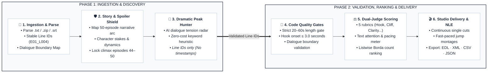

# HookScene: AI-Powered Promo Discovery for Microdramas

> **Automated promo intelligence engine that transforms 50-episode microdrama screenplays into viral, broadcast-ready 20–60s video teasers.**

[](https://hookscene.onrender.com/)
[](HookScene_Solution_Document_Final.pdf)
[](https://hookscene.onrender.com/)
[](LICENSE)

* **Live Studio App:** [https://hookscene.onrender.com/](https://hookscene.onrender.com/)
* **Official 2-Page Solution Document:** [HookScene_Solution_Document_Final.pdf](HookScene_Solution_Document_Final.pdf) *(source: [HookScene_Solution_Document_Final.md](HookScene_Solution_Document_Final.md))*
* **GitHub Repository:** [https://github.com/krishna5632/HookScene](https://github.com/krishna5632/HookScene)
* **Kuku AI Generalist Assignment:** Built for Problem 1 ("Find the Promos").

---

## 1. What HookScene Does (In Simple Words)

Microdrama platforms (like ReelShort, DramaBox, and Kuku) release new 50-episode vertical video shows every week. To acquire viewers, they post short 20–60 second video teasers on TikTok, Instagram Reels, and YouTube Shorts.

Today, a human video editor has to watch hours of raw footage by hand to find good promo scenes. **HookScene completely automates this search**:
1. It reads raw episode screenplays (`.txt` files, subtitle `.srt` files, or full `.zip` seasons).
2. It discovers high-drama moments that hook a viewer in the **first 3 seconds** and cut on a shocking **unresolved cliffhanger**.
3. It validates that the clip makes sense to a stranger who has never seen the show before.
4. It outputs broadcast-ready promo candidates (both **Continuous Single Cuts** and fast-paced **Multi-Clip Montages**) with verified millisecond cut points.

---

## 2. Core Rule: "AI Proposes, Code Disposes"

When language models (LLMs) are asked to write timestamps directly, they hallucinate arithmetic and cut actors mid-sentence. 

HookScene solves this with a **neuro-symbolic separation of concerns**:
* **The AI only names script Line IDs** (e.g. `E02_L004` to `E02_L030`) to identify dramatic tension and character conflicts.
* **Pure Python code computes every timestamp**, verifies 20–60s duration, enforces $\le 3.0$s hook onset, and snaps cuts to natural speech pauses where nobody is speaking.

---

## 3. Pipeline Architecture



### The 6 Execution Stages:
1. **Screenplay Ingestion & Tokenization:** Regex parser converts screenplay blocks into structured `Line` entities (`E01_L004`). Precomputes a safe dialogue boundary map (`cut_ok`) using screenplay timestamps to ensure cuts never clip dialogue or sound effects.
2. **Narrative Arc & Anti-Spoiler Shield:** Maps the overall story and consensus-votes late climax episodes (Eps 44–50) so endings are never spoiled in ads.
3. **Dramatic Peak Discovery:** Identifies the highest-tension moments (altar rejections, family disownments, slaps, identity reveals) returning only Line IDs.
4. **Deterministic Code Quality Gates:** Python code converts Line IDs to timestamps and enforces hard rules: clip duration must be 20–60s, dramatic hook onset $\le 3.0$s, and cliffhanger cuts before the resolution.
5. **Multi-Rubric Scoring & Ranking:** Evaluates candidates across 5 weighted rubrics (Hook 3s, Cliffhanger, Standalone Clarity, Intensity, Plot Relevance) + text attention metrics. Multi-list Borda count ranks them.
6. **Montage Synthesis & Studio Export:** Generates multi-clip jump-cut montages to eliminate dead air for TikTok feeds, and exports CMX 3600 EDL, Final Cut XML, CSV, and JSON payloads.

---

## 4. Quickstart & How to Run

### Option A: One-Command Launch with Docker (Recommended)
Run the entire platform inside a Docker container:
```bash
docker-compose up -d
```
Open **http://localhost:8080** in your browser to launch the HookScene Studio UI.

To stop the container:
```bash
docker-compose down
```

### Option B: Local Python Setup (Python 3.10+)
1. Install dependencies:
   ```bash
   pip install -r requirements.txt
   ```
2. Launch the studio server:
   ```bash
   python server.py
   ```
3. Open **http://localhost:8080** in your browser.

### Option C: Live Cloud Deployment
HookScene is live on Render:  
👉 **[https://hookscene.onrender.com/](https://hookscene.onrender.com/)**

---

## 5. Running via Command Line (CLI)

1. **Rule-Based Baseline (No API key, takes ~1 second):**
   ```bash
   python backend/scripts/run.py run --input "data/sample_show" --no-llm
   ```
2. **Full AI Pipeline:**
   ```bash
   python backend/scripts/run.py run --input "data/sample_show" --profile fast
   ```
   *Profiles:* `fast` (~3 minutes for 50 episodes), `thorough` (official benchmark run), `free_tier` (rate-limited for free keys).
3. **Run Automated Test Suite:**
   ```bash
   python -m pytest
   ```

---

## 6. Official Benchmark Results (50-Episode Pack)

Ran on the official 50-episode pack (*"I Married a Broken Soldier. He was a Duke"*, 3,727 screenplay lines, 103 minutes of footage):

| Metric | Official Result |
| :--- | :--- |
| **Total Candidates Evaluated** | 138 proposed by AI $\to$ 36 rejected by code gates |
| **Final Promo Output** | **30 single cuts + 2 montages** |
| **Hard Rule Compliance** | **32 / 32 (100%)** satisfied 20–60s length & $\le 3$s hook onset |
| **Mean Clip Duration** | **42.1 seconds** (range: 22s – 59s) |
| **Blind A/B vs Rule Baseline** | **13 wins, 4 losses, 5 ties** ($p = 0.025$ on decisive pairs) |
| **Top-Rank Consistency** | **4 of top 5 scenes match** between independent runs C and D |
| **Execution Speed** | **103 API calls in 2 min 45 sec** on fast profile |

### Top 5 Promos Picked by HookScene:
1. **Promo #1 (Ep 2, 00:00–00:45 · 45s):**  
   *Hook:* THE FORMER GROOM: *"I cannot marry you, Juliana."*  
   *Cliffhanger:* BLOND NOBLEMAN: *"Do not disgrace us further."*
2. **Promo #2 (Ep 3, 00:58–01:25 · 27s):**  
   *Hook:* NOBLE MATRIARCH: *"Guards! Remove her!"*  
   *Cliffhanger:* THE BEARDED STRANGER: *"...let her go."*
3. **Promo #3 (Ep 1, 00:11–01:02 · 51s):**  
   *Hook:* MATRIARCH: *"You should turn around, Juliana."*  
   *Cliffhanger:* JULIANA: *"I changed my mind."*
4. **Promo #4 (Ep 11, 00:17–00:51 · 34s):**  
   *Hook:* GERALD: *"Your husband stole my gold pocket watch!"*  
   *Cliffhanger:* ALEXANDER: *"Search it."*
5. **Promo #5 (Ep 12, 00:44–01:25 · 41s):**  
   *Hook:* CLARISSA: *"I want to see you crawl, sister."*  
   *Cliffhanger:* JULIANA: *"Tell me where the garden is."*

Full ranked promos with screenplay proofs are in [results/official-run-C/promos.md](results/official-run-C/promos.md).

---

## 7. Interactive Studio Features

The HookScene Studio UI (available locally or at [hookscene.onrender.com](https://hookscene.onrender.com/)) provides:
* **Review Desk:** Teleprompter display showing exact screenplay lines, audio waveforms, video simulation, and hook onset timestamps.
* **Dual Format Filter:** Easily switch between **`Single Cut`** (continuous takes) and **`Montage`** (paced jump cuts).
* **Category Radar:** Filter by emotional tone (*Romance, Conflict, Suspense, Drama, Cliffhanger*).
* **Feature 2 Failure Analysis:** Every rejected clip logs to SQLite under 6 tracked categories (*Weak Hook, Premature Cut, Unresolved Context, Audio Clipping, Spoiler Risk, Score Disagreement*).
* **Feature 3 Consistency Comparator:** Compares two runs side-by-side with Jaccard overlap, Spearman rank correlation, and score drift metrics.
* **Feature 4 Automated Test Suite:** Real-time interactive test runner executing **80 automated Pytest test cases** with live progress bars and timing telemetry.

---

## 8. Technology Stack

* **Backend:** Python 3.12, FastAPI, Uvicorn, Pydantic v2
* **Frontend:** React 18, TypeScript, Tailwind CSS, Lucide Icons, Vite
* **Storage:** SQLite (`hookscene_eval.db`) for editorial review decisions and failure tracking
* **AI Provider:** Google Gemini Flash (via OpenAI SDK client compatibility)
* **Testing:** Pytest (80/80 passed)
* **DevOps:** Docker, Docker Compose, Render (`render.yaml`)

---

## 9. Submission Deliverables

* **Solution Document:** [HookScene_Solution_Document_Final.pdf](HookScene_Solution_Document_Final.pdf) *(2-page PDF)*
* **Live App Link:** [https://hookscene.onrender.com/](https://hookscene.onrender.com/)
* **Code Repository:** [https://github.com/krishna5632/HookScene](https://github.com/krishna5632/HookScene)
* **Raw Outputs Folder:** [results/official-run-C/](results/official-run-C/) (`promos.md`, `promos.json`, `promos.csv`)

---

## 10. License

Released under the [MIT License](LICENSE). Built for the Kuku AI Generalist Assignment.
